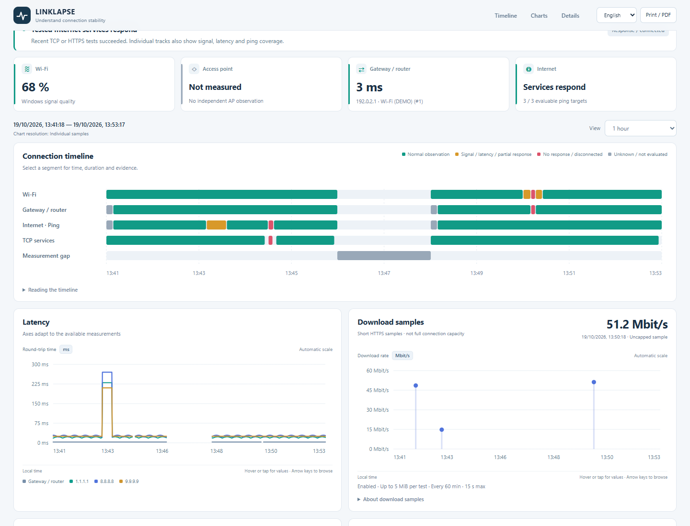

# LinkLapse

**Kostenlose WLAN- und Internet-Stabilitätsüberwachung für Windows 11.**

Das WLAN setzt immer wieder aus, aber ein kurzer Speedtest sieht unauffällig aus. LinkLapse hält Verbindungswechsel, Antwortzeiten und fehlende Antworten im Zeitverlauf fest. So lassen sich Probleme nachvollziehen und mit konkreten Messzeitpunkten melden.

Portabel · Lokale Logs · Deutsch / English · MIT

[Download für Windows](https://github.com/schorri/linklapse/releases) · [Anleitung](docs/guide.de.md) · [English](README.md)

## Loslegen

1. Release-ZIP herunterladen und vollständig entpacken.
2. **LinkLapse.exe** öffnen.
3. Im Dashboard die Dauer wählen und **Messung starten** anklicken.

Keine Konsolenbefehle und keine zusätzlichen Laufzeiten zu installieren. Die normale Messung braucht keine Administratorrechte. Netzteil anschließen und Deckel offen lassen.

## Was LinkLapse zeigt

- Gemeinsame Zeitspuren für WLAN, Gateway, Internet-Ping, TCP und Messpausen.
- Getrennte Messpfade bei VPN, LAN und WLAN.
- Optionale Download-Proben mit begrenztem Volumen, Zeitlimit und wählbarer Leserate.
- Lokale CSV-Logs und HTML-/ZIP-Berichte für die eigene Fehlersuche oder Anbieter/Vermieter.
- Messdauer von fünf Minuten bis 30 Tage oder bis zum manuellen Stoppen.

Start, Stopp, Einstellungen und Berichtsexport erfolgen im Dashboard. Diagramme passen sich dem vorhandenen Zeitraum an. Die Ansicht und die Messdauer sind unabhängig wählbar.

Geeignet für kurze Aussetzer, ein gemeinsam genutztes Gebäudenetz und Vergleiche vor und nach einer Änderung am Standort oder Aufbau. LinkLapse misst Unterschiede; es verändert keine Routereinstellungen und verspricht keine automatische Optimierung.

## Messwerte richtig lesen

Ein fehlender Ping beweist keinen Internetausfall. LinkLapse lernt zunächst antwortende Ziele kennen und trennt Rohwerte von gewerteten Ping-Proben. TCP und HTTPS liefern zusätzliche Belege.

Ein AP als Bridge taucht häufig nicht als Router-Hop auf. Ohne bestätigte Verwaltungsadresse bleibt sein eigener Zustand unbekannt. Das Programm dokumentiert Beobachtungen und mögliche betroffene Bereiche, keine bewiesene Verantwortung einzelner Geräte oder Anbieter.

## Lokal und ohne Konto

Die Oberfläche ist nur auf diesem Computer erreichbar. Es gibt keine Telemetrie und keinen Ergebnis-Upload. Messanfragen gehen an die konfigurierten Ziele. Vor Weitergabe eines Berichts interne Adressen und Adapterbezeichnungen prüfen.

Während der Messung wird Standbyschutz angefordert. Stromausfälle, manuelles Schlafen und erzwungene Neustarts bleiben möglich. Eine optionale Einstellung für den privaten Laptop pausiert automatische Windows-Updates mit Administratorfreigabe; dabei sind auch Sicherheitsupdates betroffen. Der normale Start ändert keine Update-Richtlinie.

[Vollständige Anleitung](docs/guide.de.md) · [Mitwirken](CONTRIBUTING.md) · [Lizenz](LICENSE)

Version 0.1.0 ist der erste öffentliche Release-Kandidat. Wenn LinkLapse bei der Fehlersuche hilft, unterstützt ein Stern die Auffindbarkeit des Projekts. Rückmeldungen aus längeren Messungen sind willkommen.
