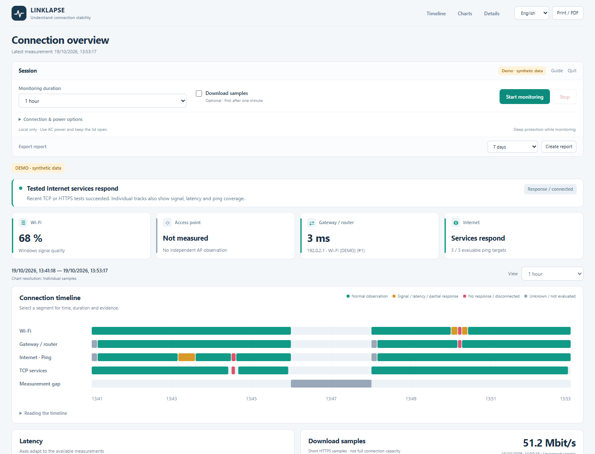

# LinkLapse

**Free Wi-Fi & Internet Stability Monitor for Windows 11.**

Wi-Fi keeps dropping, but a speed test looks fine. LinkLapse records connection changes, latency and missing replies over time, so you have more than “it was slow again” to work with.

Portable · Local logs · English / Deutsch · MIT

[Download for Windows](https://github.com/schorri/linklapse/releases) · [Getting started](docs/guide.md) · [Deutsch](README.de.md)



[View the measurement timeline](docs/assets/dashboard.png) · [Explore the charts](docs/assets/charts.png) · Screenshots use synthetic data.

## Start in three steps

1. Download the release ZIP and extract it completely.
2. Open **LinkLapse.exe**.
3. Choose a duration in the dashboard and click **Start monitoring**.

No terminal commands or additional runtimes to install. Ordinary monitoring needs no administrator rights. Keep the laptop plugged in with its lid open.

## What you get

- **A shared timeline** for Wi-Fi, gateway, Internet ping, TCP services and measurement gaps.
- **Separate routes** when a VPN, Ethernet and Wi-Fi take different paths.
- **Optional download samples** with volume, time and read-rate limits.
- **Local CSV logs** and an HTML/ZIP report for troubleshooting or a support request.
- **Useful time ranges:** five minutes to 30 days, or keep running until you stop it.

Start, stop, change the next session’s settings and export reports directly from the dashboard. The chart view scales as data accumulates. The interface is available in English and German.

Use it to investigate intermittent dropouts, document a shared building connection, or compare results before and after changing a laptop’s location or network setup. LinkLapse measures the difference; it does not change router settings or automatically “optimize” Windows.

## What the results mean

A missing ping reply does not prove an Internet outage. Some gateways and public targets do not answer ICMP reliably. LinkLapse first learns which ping targets respond, keeps raw and evaluated counts separate, and considers TCP/HTTPS results alongside ping.

An access point may be invisible to router-level path discovery. Without a confirmed management IP, its individual state stays unknown. The app records observations and plausible affected areas; it does not assign blame to a provider or a device.

[Measurement method](docs/measurement-method.md) · [Settings](docs/configuration.md) · [Troubleshooting](docs/guide.md#troubleshooting)

## Local by default

The dashboard is served only on this computer. There is no account, telemetry or result upload. Configured test endpoints receive ordinary network requests. Logs and reports can contain internal addresses and adapter names, so review them before sharing.

Sleep protection is requested during a session. It cannot prevent power loss, manual sleep or every forced restart. An optional, clearly labelled private-laptop setting can temporarily pause automatic Windows updates; it requires administrator approval and also pauses security updates. Normal monitoring leaves update policy alone.

## Development

Windows 11, Windows PowerShell 5.1 and .NET Framework 4.8. Node is used only for developer checks.

```powershell
powershell.exe -NoProfile -ExecutionPolicy Bypass -File .\tools\Build.ps1
powershell.exe -NoProfile -ExecutionPolicy Bypass -File .\tests\Run.ps1
node .\tests\Diagnostics.Tests.cjs
node .\tests\Bridge.Tests.cjs
```

The repository includes source for the launcher, local UI bridge and measurement engine. See [contributing](CONTRIBUTING.md) and [security](SECURITY.md). Version 0.1.0 is the first public release candidate; longer runs on additional home networks are welcome.

If LinkLapse helps you investigate a connection problem, a star helps others find it. Bug reports and small, tested improvements are welcome too.

[MIT license](LICENSE).
